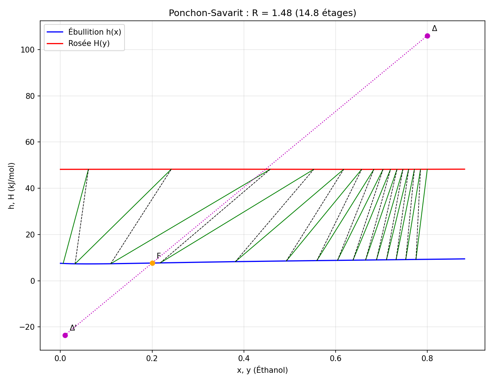
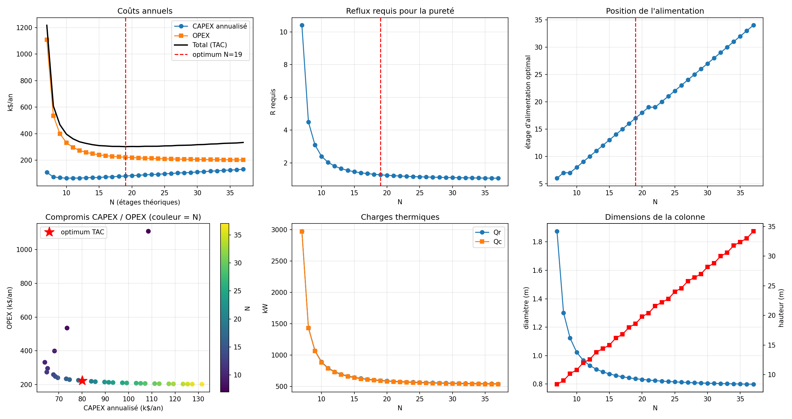

# Simulateur MESH de distillation binaire non idéale avec optimisation CAPEX/OPEX



Projet Python de génie des procédés : résolution des équations **MESH** (bilans de **M**atière, **E**quilibre,
**S**ommation, bilans de chaleur **H**) d'une colonne de distillation binaire, avec des coefficients d'activité
**NRTL** ou **UNIQUAC**, la méthode graphique/analytique de **Ponchon-Savarit**, et une **optimisation non linéaire**
du coût (CAPEX + OPEX) sur le nombre d'étages, la position de l'alimentation et le taux de reflux, sous contraintes
de pureté.

## 1. Installation et utilisation

```bash
git clone https://github.com/<ton-pseudo>/distillation-mesh.git
cd distillation-mesh
python -m pip install -r requirements.txt   # numpy, scipy, matplotlib (+ thermo, optionnel)
python tests.py                             # 23 tests automatiques
python main.py                              # éthanol/eau (par défaut), ~15 s
python main.py --systeme tous               # les 4 systèmes
python main.py --systeme methanol_eau --xD 0.97 --vapeur 40
python main.py --rapide                     # sans l'étude de sensibilité
```

Sous Windows (PowerShell), les commandes sont identiques (`python …`).

Options : `--systeme` (`ethanol_eau`, `ethanol_eau_uniquac`, `methanol_eau`, `acetone_methanol`, `tous`),
`--F --zF --xD --xW --q` (spécifications), `--vapeur` (prix de la vapeur, $/t), `--rapide`, `--sortie` (dossier).
Les résultats sont écrits dans `resultats/<système>/` : 8 figures PNG, `rapport.md`, `designs.csv`.

## 2. Organisation du code

| Fichier | Rôle |
|---|---|
| `main.py` | Lance toute l'étude pour un ou plusieurs systèmes et écrit les résultats |
| `tests.py` | 23 tests (thermodynamique, bilans, équivalence MESH/PS, optimisation) |
| `distil/components.py` | Données des corps purs (Antoine, Cp, chaleur latente, Tc, paramètres UNIQUAC r et q) |
| `distil/systemes.py` | Systèmes binaires (paramètres NRTL/UNIQUAC, spécifications par défaut, données expérimentales) |
| `distil/thermo_models.py` | γ (NRTL, UNIQUAC), équilibre L-V, enthalpies (avec enthalpie d'excès), tables d'équilibre |
| `distil/ponchon_savarit.py` | Construction graphique/analytique des plateaux, pôles Δ et Δ', R_min |
| `distil/mesh.py` | **Solveur MESH rigoureux** (Newton amorti, jacobien par différences finies colorées) |
| `distil/economics.py` | Modèle de coût : dimensionnement, CAPEX, OPEX, coût annuel total (TAC) |
| `distil/optimisation.py` | Optimisation sur N, N_F, R et vérification par NLP (SLSQP) |
| `distil/validation.py` | Validation : données expérimentales, bibliothèque `thermo`, équivalence PS/MESH |
| `distil/graphiques.py` | Toutes les figures |

## 3. Modèle

**Équilibre.** Loi de Raoult modifiée, vapeur idéale : `y_i P = x_i γ_i Psat_i(T)` (Antoine). Pour le binaire,
la température de chaque étage vient de `K_A x + K_B (1-x) = 1` (équation de sommation).

**NRTL.** `τ_ij = b_ij/T`, `G_ij = exp(-α τ_ij)`.
**UNIQUAC.** Partie combinatoire (r, q, z = 10) + partie résiduelle, `τ_ij = exp(b_ij/T)`.
Les deux sont codés à la main et identiques à la bibliothèque `thermo` (écart ~1e-15).

**Enthalpies** (référence : liquides purs à 0 °C) :
`h(x,T) = Σ x_i Cp_i (T - T_ref) + h^E`, avec `h^E = -R T² ∂(Σ x_i ln γ_i)/∂T` (dérivée numérique),
`H(y,T) = Σ y_i [Cp_i (T - T_ref) + λ_i(T)]`, `λ_i(T)` par la corrélation de Watson.

**MESH.** Colonne à N étages théoriques (1 = tête, N = rebouilleur), condenseur total, une alimentation à l'étage N_F.
Spécifications : distillat D et taux de reflux R = L₀/D. Inconnues (4N + 1) : `x_j, T_j, L_j, V_j, Q_R, T_0`.
Équations par étage j :

```
L_{j-1} + V_{j+1} + F_j - L_j - V_j = 0                              (matière totale)
L_{j-1} x_{j-1} + V_{j+1} y_{j+1} + F_j zF - L_j x_j - V_j y_j = 0   (composant léger)
K_A x_j + K_B (1 - x_j) - 1 = 0 ,  y_j = K_A x_j                     (équilibre + sommation)
L_{j-1} h_{j-1} + V_{j+1} H_{j+1} + F_j h_F - L_j h_j - V_j H_j + Q_j = 0   (énergie)
```

Résolution par Newton amorti. Le jacobien est tridiagonal par blocs : on le calcule par différences finies
« colorées » (14 évaluations du résidu par itération, quel que soit N). Convergence typique : 5 itérations, < 0,05 s.
Les débits L et V ne sont **pas** supposés constants (pas d'hypothèse de débits molaires constants).

**Ponchon-Savarit.** Pôles `Δ = (x_D, h_D + (R+1)(H_1 - h_D))` et `Δ'` à `x_W` sur la droite Δ-F ; conodales issues de
l'équilibre, droites opératoires passant par le pôle ; changement de pôle quand une conodale coupe la droite Δ-F
(alimentation optimale). Avec le même modèle d'enthalpies, Ponchon-Savarit est **exact** pour un binaire : il doit
donner la même solution que le MESH (voir validation).

**Coûts.** Plateaux réels `N_réel = (N-1)/E_o`. Diamètre à vitesse de vapeur fixée, hauteur = plateaux × pas + marge.
CAPEX = facteur d'installation × (virole + plateaux + échangeurs en `(A/10)^0.65`) ; OPEX = vapeur + eau de
refroidissement. `TAC = OPEX + CAPEX × CRF` (CRF = facteur d'annuité, 10 %/10 ans). Les coefficients sont des
**ordres de grandeur** à remplacer par ceux de ton cours (`ParamsEco` dans `economics.py`).

**Optimisation.** D est fixé par les bilans globaux avec les deux puretés. Pour chaque (N, N_F), le plus petit R qui
donne `x_D = x_D,spec` est trouvé par recherche de racine (Brent) sur le MESH complet ; N_F est optimisé par descente
discrète ; N est parcouru ; on retient le minimum du TAC. Un **NLP continu (SLSQP)** sur (R, D) avec les contraintes
`x_D ≥ x_D,spec` et `x_W ≤ x_W,spec` vérifie ensuite l'optimalité locale.

## 4. Résultats (éthanol/eau, NRTL, zF = 0,2, xD = 0,80, xW = 0,01, F = 100 kmol/h, q = 1)

| Grandeur | Valeur |
|---|---|
| Azéotrope du modèle | x = 0,881, 78,10 °C (expérience : 0,894 ; 78,15 °C) |
| R_min (Ponchon-Savarit) | 0,989 |
| Optimum | N = 19 étages théoriques (26 plateaux réels), alimentation étage 17, R = 1,27 (1,28 × R_min) |
| Colonne | Ø 0,84 m, H 18,6 m, Qc = 590 kW, Qr = 597 kW |
| Coûts | CAPEX 492 k$, OPEX 222 k$/an, TAC 302 k$/an |



Autres systèmes (même procédure) : voir `resultats/<système>/rapport.md`.

**Validation :**
- γ et h^E identiques à `thermo` (écart ~1e-15) pour NRTL et UNIQUAC ;
- 14 points expérimentaux éthanol/eau (données de manuel) : RMSE(y) = 0,009, RMSE(T) = 0,29 °C ;
- bilans de matière, de composant et d'énergie du MESH fermés à ~1e-14 ;
- **cohérence MESH/Ponchon-Savarit** : écart max sur les compositions de plateau < 4e-8 sur les 4 systèmes (les deux méthodes partagent le même modèle thermodynamique : c'est un test de cohérence interne, pas une validation indépendante) ;
- NLP SLSQP : confirme l'optimum du balayage discret.

## 5. Limites

- Étages théoriques (efficacité globale appliquée après coup), pression constante (pas de perte de charge),
  condenseur total, une seule alimentation, mélange binaire (pas de multicomposant).
- Cp liquides constants, vapeur idéale, enthalpies de mélange en phase vapeur négligées.
- Paramètres NRTL/UNIQUAC de type ChemSep (ajustés sur des données de manuel) : à remplacer par ceux de ton cours ou de DECHEMA pour un travail officiel.
- Les données expérimentales éthanol/eau sont des valeurs de manuel (à vérifier avec ta référence avant citation).
- Modèle de coût d'ordre de grandeur (R_opt/R_min varie de 1,1 à 1,5 selon les prix de l'énergie ; voir `08_sensibilite_vapeur.png`).
- Si xD est trop proche de l'azéotrope, le nombre d'étages explose : une seule colonne ne peut pas dépasser l'azéotrope.

## 6. Ajouter un système

Dans `distil/systemes.py`, copie une fonction (`_ethanol_eau`) et change : les deux corps purs (clés de `components.py`,
à ajouter si besoin), le modèle (`"NRTL"` avec `b12, b21, alpha`, ou `"UNIQUAC"` avec `b12, b21`), et les spécifications
par défaut ; puis ajoute-le au dictionnaire `SYSTEMES`. Le composant A doit être le plus volatil.

## 7. Pistes d'extension

Perte de charge par plateau, efficacité de Murphree par étage, plusieurs alimentations ou soutirages, colonne
extractive/pression variable pour franchir l'azéotrope, multi-composants (Naphtali-Sandholm), corrélations de coût
Turton avec indice CEPCI, front de Pareto multi-objectif réel (CAPEX vs OPEX).
